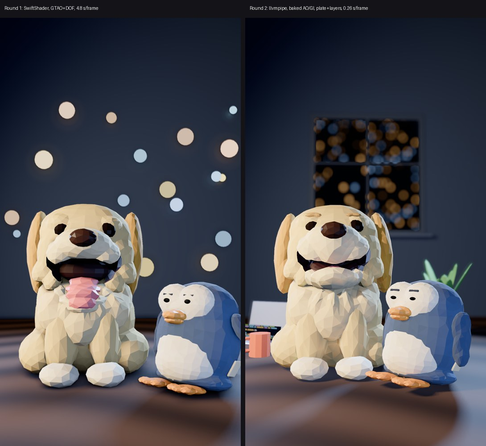

# three.js renderer POC

## Round 2: speed + detail



**Result:** at 1080×1920 the full-quality frame costs **0.26 s** (render + capture + H.264 encode). The Round 1 pipeline, measured
on the same host in the same run, costs **4.8 s**. The target was ≤ 2 s. Most of the gain comes from switching the software GL
backend (SwiftShader → Mesa llvmpipe, about 5×) and from rendering the static background only once per shot (about 3×).
Everything stays deterministic. The demo is [`out/demo_v2.mp4`](out/demo_v2.mp4): 6 s, 30 fps, with audio.
It renders in **50 s of wall time**, so a 25 s short at 30 fps takes about 3.3 min instead of about 1 h.

### What changed

**Assets** (`character/blender/export_gltf_v2.py`, which writes `joey2.glb`, `hugsy2.glb`, `props.glb`, `whiteboard.glb` and `scene2.json`).
The v1 exporter is untouched, so the baseline can still be reproduced.
- **Baked AO + GI.** Cycles bakes the duo in place, with the desk, wall and lights, to a second per-corner colour attribute
  (`COLOR_1`: rgb = indirect diffuse irradiance, a = AO). It runs once per export and takes about 90 s at 64 spp. In three.js an
  `onBeforeCompile` hook uses AO to occlude the ambient and environment light (and 35 % of the direct light, for contact
  darkening) and adds `albedo × irradiance` as a warm bounce. Runtime GTAO is off.
- **Morph targets** (Blender shape keys exported as glTF morphs; flat shading still faceted because normals come from derivatives):
  - Joey muzzle, head and mouth: `Wide`, `Narrow`, `Smile` (cheek squash), and `Close` (the upper lip drops over the carved mouth, so M/B/P really close).
  - Joey jaw: `Wide`, `Narrow`, `FV`. Joey tongue: `In`, `Up`.
  - New low-poly **brow tufts** `Joey_Brows`: `Up`, `Down`, `Worried`, `Angry`.
  - Hugsy beak: `Open` (upper and lower). Hugsy body, belly and face: `Squash` / `Stretch`. These share one world-space field, so the separate meshes stay glued together.
  - Hugsy brows: `InnerDown` (flat/deadpan), `InnerUp`, `Raise` (sarcastic, one side).
- **Set dressing** in the same faceted style: a laptop with a glowing code screen, a mug, a plant, and a window frame. The wall
  now has a real opening onto a procedural night city with lit windows that blur into bokeh. This replaces the floating bokeh
  spheres. A **whiteboard** asset is exported for future explainers but isn't placed in this shot.

**Renderer** (`scene2.js`, `render2.mjs`, `bench2.mjs`)
- **Plate + character layer.** The background (wall, window, city, desk, props) is rendered once per shot into an HDR plate,
  with DOF (160-tap gather, a stylised aperture that only blurs outside a focus band around the characters). The *rest-pose
  shadows of the characters* are included. Gotcha: three.js picks shadow casters using the **main camera's** layers, so the
  characters stay in that pass with colour and depth writes turned off.
  Each frame then renders only the characters, with MSAA 4×, inside their screen rect for the whole shot (`setViewOffset`,
  68 % of the frame here). One composite pass then reprojects the plate through the plane at the focus distance (this is exact
  for rotations and the handheld drift, and approximate for the slow push-in), lays the characters over it, and applies AgX
  tone mapping. Against a full per-frame render the mean difference is **2/255**: the plate's character shadows don't follow
  the animation, but the differences are tiny.
  The `--no-plate` full mode is still available for moving cameras: 0.7 s/frame with baked AO + DOF on llvmpipe.
- **Backend:** Mesa **llvmpipe** via `--use-angle=gl` in a *headed* Chromium under `xvfb-run`. Headless Chromium silently
  falls back to SwiftShader. On the same frames, llvmpipe output matches SwiftShader to within 0.3/255 mean.
- **Capture:** `readPixels` gives RGBA8, which goes to `fetch(POST, new Blob([px]))`, then the Node server, then ffmpeg stdin
  (`rawvideo`, vflip). The `Blob` matters: a raw `Uint8Array` body takes 346 ms per 8 MB frame, a Blob takes 60 ms.
  Upload of frame *i* overlaps rendering of frame *i+1*.
- **Shadows:** VSM 1024 with `shadow.focus` 0.45 (a tighter frustum, so the same detail as 2048), and `normalBias` 0.03,
  which removes the speckle and seam acne along mesh intersections.

**Animation** (`anim.js`). Pure function of t. Springs are stepped at a fixed 1/240 s from t = 0, so any frame order gives the same result.
- **Lip-sync:** Rhubarb cues (A–H, X) → jaw angle + `Close`/`Wide`/`Narrow`/`FV` morphs and the tongue, with 60 ms crossfades
  and a spring on the jaw. Between lines Joey goes back to his open "happy pant".
- **Secondary motion:** the ears are pendulum springs driven by the head's angular acceleration. The tongue lags the jaw.
  The head follows its target through a spring, which gives follow-through. Hugsy's far flipper follows through, and his body
  squashes and stretches (volume-preserving scale + `Squash`/`Stretch` morphs) on the flipper move.
- **Acting:** easing with anticipation and overshoot (`anticOver`). Joey's excited head pop starts with a frown dip.
  Hugsy does a deadpan squint (half lids, flat brows), glances at the camera, raises the near flipper at Joey, and then raises
  one brow sarcastically. Joey then tilts his head with worried brows.
- **Idle life:** breathing on both characters, smoothed-noise head drift, eye saccades, seeded natural blinks (2–5.5 s gaps,
  some doubles), and handheld camera drift (about 0.15°, about 1 cm) on top of a 7 % push-in.

**Voice:** Chatterbox with the repo's `joey` preset (`scripts/tts.py --voice joey`, set up with `scripts/setup_voice.sh`)
says "Whoa! This robot just learned to make pancakes!" (3.4 s). Generation took 185 s on CPU while Blender was baking.
The visemes come from **Rhubarb Lip Sync 1.14.0** (MIT, prebuilt Linux binary), using the text as a dialog hint.
Both are stored in `../timelines/` (`demo_v2.json`, `demo_v2_joey.wav`).

### Benchmark v2 (1080×1920, 4 vCPU, no GPU, one consistent run)

The host's speed drifts between sessions: the identical Round 1 frame measured 6.0, 8.5 and 4.8 s/frame on different
occasions. **Only compare rows within this table.** "Frame" = `renderAt` + `readPixels` (forces the GPU to finish).
"Pipelined" = frame + upload, overlapped.

| # | config | SwiftShader s/frame | llvmpipe s/frame |
|---|---|---|---|
| 0 | **Round 1 pipeline** (r1 scene, GTAO + DOF, MSAA 4, VSM 2048, PNG capture) | **4.78** | – |
| 1 | v2 scene, same settings as Round 1 (GTAO + DOF, MSAA 4, VSM 2048) | 4.70 | 1.10 |
| 2 | + baked AO/GI, GTAO off (B1) | 3.11 | 0.68 |
| 3 | + DOF with 20 instead of 40 taps (≈ half-res DOF cost) | 2.73 | 0.55 |
| 4 | DOF off entirely | 2.35 | 0.40 |
| 5 | (2) + shadows 1024 + tight focus | 2.58 | 0.57 |
| 6 | (2) + shadows 512 + tight focus | 2.37 | 0.54 |
| 7 | **plate**: background once, characters per frame (B2), MSAA 4 | 1.16 | 0.23 |
| 8 | plate, MSAA 2 | 1.18 | 0.23 |
| 9 | plate, SMAA instead of MSAA | 1.03 | 0.20 |
| 10 | plate, no AA | 0.75 | 0.14 |
| 11 | plate, PCF-soft instead of VSM | 1.09 | 0.20 |
| 12 | **layered plate** (characters inside their rect + one composite/tonemap pass), MSAA 4, VSM 1024 | **1.02** | **0.20** |
| 13 | layered, MSAA 4, PCF | 0.87 | 0.20 |
| 14 | layered, MSAA 2, PCF | 0.89 | 0.16 |
| 15 | layered, no AA | 0.63 | 0.11 |

The plate itself costs 0.8–1.7 s **once per shot**. Capture (B5): a raw Blob upload costs 0.03–0.06 s, against 0.13–0.34 s
for a PNG encode alone (Round 1 used PNG + disk + a PNG decode in ffmpeg). Pipelined, the upload is almost fully hidden.

Backend threads (row 12, llvmpipe): `LP_NUM_THREADS=2` gives 0.35 s, the default (4) gives 0.20 s, 8 gives 0.20 s.

**Parallel workers (B3)**, end-to-end wall time per frame including the x264 encode, 72 frames:

| workers | layered plate (row 12), llvmpipe | full mode (row 2), llvmpipe | layered plate, SwiftShader (earlier run) |
|---|---|---|---|
| 1 | **0.26** | 0.67 | 1.10 |
| 2 | 0.24 | 0.61 | 1.09 |
| 3 | 0.25 | – | 1.18 |

One browser process already saturates the 4 vCPUs (both rasterisers are multithreaded), so extra workers buy ≤ 10 %
and cost RAM. Keep **1 worker** (2 if RAM allows). The code supports N workers rendering interleaved frames.

**Frame dedupe (B4)** is implemented: a pose pre-pass hashes every transform, morph weight and the camera matrix, and
duplicate frames are re-sent instead of rendered. On this demo it found **0 duplicates**, because the idle life
(breathing, drift, handheld camera) keeps every frame unique. It will pay off on holds, title cards and frozen
"pause" beats.

**24 vs 30 fps (A6):** at 0.26 s/frame a 25 s short costs 2.6 min at 24 fps and 3.3 min at 30 fps. **30 fps is the
default.** Springs and noise are time-based, so the fps doesn't change the motion.

### Before / after

| | Round 1 | Round 2 |
|---|---|---|
| s/frame at 1080×1920 (same host, same run) | 4.78 (6.0 on the Round 1 host) | **0.26** end to end |
| 25 s short | ~40–60 min | **~3.3 min @ 30 fps** |
| AO | screen-space GTAO (subtle, view-dependent) | Cycles-baked per corner, so stable and denser in the creases |
| Warm bounce (the main Round 1 gap) | missing; shadow sides went grey-blue | baked indirect light warms under the chin, the legs and Hugsy's belly edge. Not quite as saturated as Cycles. |
| Background | floating emissive dots | window with a blurred night city, laptop, mug, plant |
| Mouth | jaw sine wave | Rhubarb visemes (9 shapes), real closures on M/B/P |
| Faces | eyes scale, a brow bar | brow morphs, cheek squash, saccades, natural blinks, deadpan lids |
| Motion | sine waves | springs (ears, tongue, flippers, head), anticipation + overshoot, squash/stretch, breathing, handheld drift |
| Determinism | yes | yes, including the springs (fixed-step re-sim) |

Known limitations:
- The plate's character shadows are frozen at the shot's first pose. Big moves would need `--no-plate` or a per-frame
  shadow catcher.
- The plate is reprojected for the push-in through the focus plane, which gives about 2 % parallax error on the
  far wall: invisible under the blur.
- The baked GI is for the rest pose only.
- The Chatterbox line was generated once, and its timing drives the cues (6 s timeline).

### How to run (Round 2)

```bash
mkdir -p .blender && curl -L https://download.blender.org/release/Blender4.2/blender-4.2.3-linux-x64.tar.xz | tar xJ -C .blender
cd character/blender && ../../.blender/blender-4.2.3-linux-x64/blender -b --factory-startup -P export_gltf_v2.py -- --samples 64  # ~2.5 min (bake)
cd ../threejs && npm install
./make_demo_v2.sh                                   # out/demo_v2.mp4 (REGEN=1 RHUBARB=... to redo the voice + visemes)
xvfb-run -a node render2.mjs --still --backend llvmpipe --timeline ../timelines/demo_v2.json --t 4.9 --out out/s.png
xvfb-run -a node bench2.mjs --backend llvmpipe      # table above (drop xvfb-run/--backend for SwiftShader)
xvfb-run -a node bench2.mjs --backend llvmpipe --throughput --workers 1,2,3
```
`render2.mjs` options: `--no-plate`, `--ao baked|gtao|none`, `--aa msaa|smaa|none`, `--msaa N`, `--shadow N`, `--workers N`,
`--no-dedupe`, `--fps`, `--timeline`, `--audio`, and `--json '{…}'` for any `setup()` option (look tuning:
`bakeGI`, `bakeAO`, `hemi`, `dofBoost`, `band`, `city`…).

### Recommendation

**Adopt it as the daily renderer.** Use llvmpipe + layered plate for static or slowly pushing shots (0.26 s/frame), and full
mode (`--no-plate`, 0.7 s/frame) for shots with real camera moves. Both are well under the 2 s target, so a 25 s short takes
3–8 minutes of CPU, and the budget now goes to voice (Chatterbox is the slow step at roughly 7–50× real time) rather than to rendering.

Next:
1. Generate the timeline from the script (shot list → camera + acting beats, Rhubarb per line).
2. Add more viseme polish (teeth, a tongue-tip L).
3. Add a per-frame shadow catcher option for big moves.
4. Bake a second GI pose for close-ups.

---

# Round 1

Can three.js in headless Chromium (software WebGL via SwiftShader, no GPU) replace Blender Cycles for the
low-poly Joey / Ball / Hugsy shots? This folder renders the same duo shot as `character/renders/duo.png`
from the same Blender-built meshes, and benchmarks it.


## Pipeline

1. **Characters → glTF** (`character/blender/export_gltf.py`). Builds Joey + Ball (and Hugsy) with the
   existing `build_*.py` scripts, headless in portable Blender 4.2.3 LTS, and exports `character/gltf/{joey,ball,hugsy}.glb`
   plus `scene.json`, which holds the camera, the 4 area lights, the 28 bokeh spheres, material parameters and the focus point. All of them are taken from
   `preview_duo_base.py`, the script that made `duo.png`, so both renderers use the same layout.
   - Object names, hierarchy and pivots are kept: `Joey_Jaw` (→ `Joey_Tongue`), `Joey_EyeL/R`, `Joey_EarL/R`, `Joey_Head`,
     `Ball_EyeL/R`, `Hugsy_FlipperL/R`, `Hugsy_EyeL/R`, `Hugsy_Brows`, `Hugsy_Beak` (→ `Hugsy_BeakLower`)…
   - Colour: albedo × per-face `tint` is baked into a per-corner `COLOR_0`, and meshes stay flat-shaded (split normals), so
     the faceted shimmer is kept. Roughness, sheen, coat and specular are carried in `scene.json`.
   - The Hugsy builder (WIP) exported fine.
2. **Scene** (`index.html` + `scene.js`, three.js **0.169.0** from npm, plain ES modules + import map, no bundler).
   - Camera matches Blender exactly: 65 mm lens, 36 mm horizontal sensor → 52.4° vertical FOV at 9:16.
   - Lights: each Blender area light becomes a spot light at the same position and colour. Soft **VSM** shadows from the key and the rim light.
     A PMREM environment map built from the same light rectangles gives the glossy highlights on eyes, nose and desk.
   - **GTAO** ambient occlusion reuses the scene depth buffer. Normals are reconstructed from depth, which is exact for flat shading.
   - **DOF**: a custom gather shader with a physical circle of confusion (f/3.2, focus on `Joey_Head`). Bokeh lights are the
     same emissive spheres as in Blender, plus a faint additive glow sprite that stands in for the light they throw on the wall.
   - **AgX** tone mapping. The Blender reference also used AgX: `preview*.py` asks for Filmic, but in 4.2 the check silently
     falls back to AgX with no look.
3. **Renderer** (`render.mjs`): Playwright 1.56.1 with the preinstalled Chromium (`/opt/pw-browsers`; set `CHROMIUM_PATH` if
   the versions ever mismatch), launched with `--use-angle=swiftshader`. A tiny static server serves the files. Each frame calls `window.renderAt(t)`.
   There's no realtime clock, so the same `t` always gives the same frame. The canvas uses `preserveDrawingBuffer` → `toDataURL` → PNG, then
   ffmpeg encodes H.264 / yuv420p / 24 fps.

## How to run

```bash
# 1. Blender (once per container; gitignored)
mkdir -p .blender && curl -L https://download.blender.org/release/Blender4.2/blender-4.2.3-linux-x64.tar.xz | tar xJ -C .blender
cd character/blender && ../../.blender/blender-4.2.3-linux-x64/blender -b --factory-startup -P export_gltf.py   # ~15 s
# 2. three.js
cd ../threejs && npm install                      # three + playwright (PLAYWRIGHT_SKIP_BROWSER_DOWNLOAD=1 is preset)
node render.mjs --still                           # out/still.png (duo with Ball, t=0)
node render.mjs --still --sidekick hugsy --t 1.7
node render.mjs --anim --sidekick hugsy           # 3 s test → out/frames/*.png + out/test_anim.mp4
node bench.mjs --n 3                              # benchmark table below
python3 compare.py ../renders/duo.png out/still.png compare.png
```

Options: `--w/--h`, `--no-dof`, `--no-ao`, `--no-shadows`, `--tone agx|aces|neutral`, and `--json '{"exposure":0.42,...}'` for any
look parameter in `setup()`. `regions.py` prints mean colours of matching regions in two renders, which is how the look was calibrated.

`test_anim.mp4` is the 3 s test (Hugsy variant). Joey talks with his jaw, blinks twice and wiggles his ears. Hugsy squints with lowered brows
and lifts a flipper. The camera pushes in slowly.

## Benchmark (same 4-vCPU container, no GPU)

three.js / SwiftShader, duo shot, MSAA 4×, 2 soft-shadow lights. The time is the mean of 3 frames after a warm-up. Capture is canvas → PNG → disk.

| Resolution | DOF | AO | render s/frame | + PNG capture | **total s/frame** |
|---|---|---|---|---|---|
| 1080×1920 | on | on | 5.85 | 0.15 | **6.0** |
| 1080×1920 | off | on | 4.80 | 0.15 | 4.95 |
| 1080×1920 | on | off | 3.60 | 0.13 | 3.73 |
| 1080×1920 | off | off | 2.69 | 0.13 | 2.82 |
| 720×1280 | on | on | 2.96 | 0.08 | **3.04** |
| 720×1280 | off | on | 2.75 | 0.08 | 2.83 |
| 720×1280 | on | off | 2.33 | 0.08 | 2.41 |
| 720×1280 | off | off | 1.77 | 0.07 | 1.84 |
| 720×1280 lean (no MSAA, key shadow only) | off | off | 1.41 | 0.08 | 1.49 |

The full 72-frame animation at 1080×1920 with everything on took **6.0 s/frame, 7.4 min wall** for 3 s of video. Page setup takes about 0.5 s.

Blender Cycles for comparison:

| | s/frame |
|---|---|
| 1080×1920, 48 spp + OIDN (reported in the brief) | 120–180 |
| 723×1286, 16 spp + OIDN, measured here (single still, includes scene build/BVH) | 29.3 |
| 720×1280, 16 spp, during animation (reported) | 15–20 |

**Speed-up:** about **25×** at final quality (1080p, 6 s vs ~150 s) and about **5–10×** at 720p (3 s vs 15–20 s).
A 25 s short at 24 fps is 600 frames:

| | 1080p wall time for 25 s |
|---|---|
| Cycles 48 spp | ~25 h |
| three.js, everything on | **~1 h** |
| three.js 1080p, no AO (DOF kept) | ~37 min |

There is room left: render the 1080p frames with 2× MSAA, or render shadow maps at a lower size. Frames can also be rendered in 2 browser
processes in parallel (SwiftShader only used about 2.5 of the 4 cores).

## Quality comparison

What matches:
- Framing, geometry and the faceted low-poly look are identical, because it's the same mesh, flat-shaded and with the same per-face tint shimmer.
- Overall exposure and palette: night-blue wall, warm key from front-left, cool rim, dim warm and cool bokeh discs of varied sizes at the
  same positions. Region averages are within about 10–15 sRGB levels on the wall, Joey's head and chest, the ears and the desk.
- Eyes and nose get glossy highlights from the env map. The ball seam reads clearly.
- Soft key shadow, plus the ball's rim shadow on the desk, which grounds it like in Cycles.

Where it's worse:
- **No global illumination.** Cycles' bounce light gives the fur warm, saturated shading in its shadowed areas, for example Joey's right cheek and under the chin.
  In three.js those areas go slightly grey-blue from the fill and rim light, so the fur reads a bit paler and colder overall.
  The hemisphere light's warm ground colour only partly compensates.
- **Mouth cavity.** Cycles makes it a deep warm dark. In three.js a few large facets of the mouth backing are lit blue at the lip edge.
  GTAO helps only a little, and a per-material env-light reduction was needed.
- **Contact shadows** under Joey's paws and body are weaker. GTAO is subtle; Cycles' area-light shadows are softer and denser.
- Desk: the procedural wood is a canvas texture, and the far desk edge shows brighter stripes than in Cycles.
  The ball needed an albedo cut (×0.62) to stand in for the Cycles fuzz bump map.
- Bokeh discs are a bit crisper. The glow around them is a sprite, not real emitted light.
- SSS and sheen are only approximated. MeshPhysical sheen had to be turned down a lot to avoid a white haze.

Viewed at phone size, the three.js frame reads as the same show, but a side-by-side shows it as the flatter "real-time" version.
Most viewers won't see the difference at 1080×1920 on a phone. The missing warmth of GI is the most noticeable gap.

## Recommendation: **hybrid, with three.js as the daily renderer**

- **Use three.js for daily animation.** About 1 h of CPU for a 25 s short at 1080p with every effect on, compared with ~25 h for Cycles.
  Cycles only fits the daily schedule at 720p and around 16 spp (~2.5–3.5 h), and the quality loss there is bigger than the
  three.js gap. Determinism and frame capture already work, and the same Playwright + ffmpeg stack is what the plan uses for the
  HTML/GSAP motion graphics. Captions, whiteboard and overlays can live in the same page.
- **Keep Blender as the authoring tool.** Characters stay built procedurally in `build_*.py` and are exported with
  `export_gltf.py`. Use Cycles for hero stills where the extra quality pays: thumbnails, cover frames and the channel avatar.
  One still at 48 spp takes 2–3 min.
- Next steps if we go this way:
  1. Bake ambient occlusion and a GI-ish warm bounce into the vertex colours in Blender (Cycles bake, once per character).
     That closes most of the visible gap at zero runtime cost.
  2. Drive `renderAt(t)` from the Rhubarb/timing JSON instead of the sine-wave test animation.
  3. Try 2 parallel browser workers and 2× MSAA to bring 1080p closer to ~3 s/frame.
