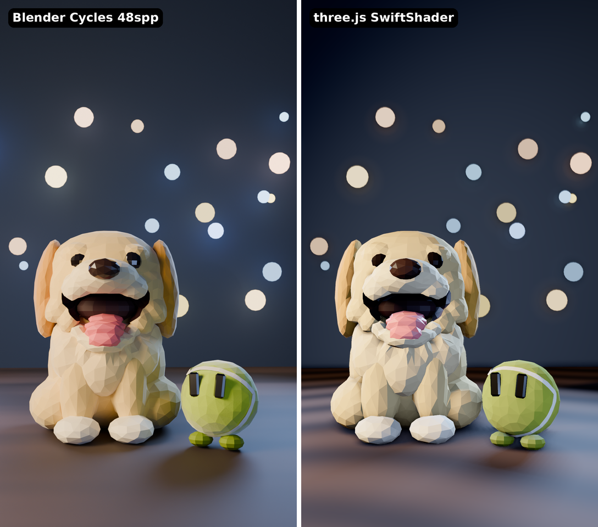

# three.js renderer POC

Can three.js in headless Chromium (software WebGL via SwiftShader, no GPU) replace Blender Cycles for the
low-poly Joey / Ball / Hugsy shots? This folder renders the same duo shot as `character/renders/duo.png`
from the same Blender-built meshes, and benchmarks it.



## Pipeline

1. **Characters → glTF** (`character/blender/export_gltf.py`). Builds Joey + Ball (and Hugsy) with the
   existing `build_*.py` scripts, headless in portable Blender 4.2.3 LTS, and exports `character/gltf/{joey,ball,hugsy}.glb`
   plus `scene.json`, which holds the camera, the 4 area lights, the 28 bokeh spheres, material parameters and the focus point. All of them are taken from
   `preview_duo_base.py`, the script that made `duo.png`, so both renderers use the same layout.
   - Object names, hierarchy and pivots are kept: `Joey_Jaw` (→ `Joey_Tongue`), `Joey_EyeL/R`, `Joey_EarL/R`, `Joey_Head`,
     `Ball_EyeL/R`, `Hugsy_FlipperL/R`, `Hugsy_EyeL/R`, `Hugsy_Brows`, `Hugsy_Beak` (→ `Hugsy_BeakLower`)…
   - Colour: albedo × per-face `tint` is baked into a per-corner `COLOR_0`, and meshes stay flat-shaded (split normals), so
     the faceted shimmer is kept. Roughness, sheen, coat and specular are carried in `scene.json`.
   - The Hugsy builder (WIP) exported fine.
2. **Scene** (`index.html` + `scene.js`, three.js **0.169.0** from npm, plain ES modules + import map, no bundler).
   - Camera matches Blender exactly: 65 mm lens, 36 mm horizontal sensor → 52.4° vertical FOV at 9:16.
   - Lights: each Blender area light becomes a spot light at the same position and colour. Soft **VSM** shadows from the key and the rim light.
     A PMREM environment map built from the same light rectangles gives the glossy highlights on eyes, nose and desk.
   - **GTAO** ambient occlusion reuses the scene depth buffer. Normals are reconstructed from depth, which is exact for flat shading.
   - **DOF**: a custom gather shader with a physical circle of confusion (f/3.2, focus on `Joey_Head`). Bokeh lights are the
     same emissive spheres as in Blender, plus a faint additive glow sprite that stands in for the light they throw on the wall.
   - **AgX** tone mapping. The Blender reference also used AgX: `preview*.py` asks for Filmic, but in 4.2 the check silently
     falls back to AgX with no look.
3. **Renderer** (`render.mjs`): Playwright 1.56.1 with the preinstalled Chromium (`/opt/pw-browsers`; set `CHROMIUM_PATH` if
   the versions ever mismatch), launched with `--use-angle=swiftshader`. A tiny static server serves the files. Each frame calls `window.renderAt(t)`.
   There's no realtime clock, so the same `t` always gives the same frame. The canvas uses `preserveDrawingBuffer` → `toDataURL` → PNG, then
   ffmpeg encodes H.264 / yuv420p / 24 fps.

## How to run

```bash
# 1. Blender (once per container; gitignored)
mkdir -p .blender && curl -L https://download.blender.org/release/Blender4.2/blender-4.2.3-linux-x64.tar.xz | tar xJ -C .blender
cd character/blender && ../../.blender/blender-4.2.3-linux-x64/blender -b --factory-startup -P export_gltf.py   # ~15 s
# 2. three.js
cd ../threejs && npm install                      # three + playwright (PLAYWRIGHT_SKIP_BROWSER_DOWNLOAD=1 is preset)
node render.mjs --still                           # out/still.png (duo with Ball, t=0)
node render.mjs --still --sidekick hugsy --t 1.7
node render.mjs --anim --sidekick hugsy           # 3 s test → out/frames/*.png + out/test_anim.mp4
node bench.mjs --n 3                              # benchmark table below
python3 compare.py ../renders/duo.png out/still.png compare.png
```

Options: `--w/--h`, `--no-dof`, `--no-ao`, `--no-shadows`, `--tone agx|aces|neutral`, and `--json '{"exposure":0.42,...}'` for any
look parameter in `setup()`. `regions.py` prints mean colours of matching regions in two renders, which is how the look was calibrated.

`test_anim.mp4` is the 3 s test (Hugsy variant). Joey talks with his jaw, blinks twice and wiggles his ears. Hugsy squints with lowered brows
and lifts a flipper. The camera pushes in slowly.

## Benchmark (same 4-vCPU container, no GPU)

three.js / SwiftShader, duo shot, MSAA 4×, 2 soft-shadow lights. The time is the mean of 3 frames after a warm-up. Capture is canvas → PNG → disk.

| Resolution | DOF | AO | render s/frame | + PNG capture | **total s/frame** |
|---|---|---|---|---|---|
| 1080×1920 | on | on | 5.85 | 0.15 | **6.0** |
| 1080×1920 | off | on | 4.80 | 0.15 | 4.95 |
| 1080×1920 | on | off | 3.60 | 0.13 | 3.73 |
| 1080×1920 | off | off | 2.69 | 0.13 | 2.82 |
| 720×1280 | on | on | 2.96 | 0.08 | **3.04** |
| 720×1280 | off | on | 2.75 | 0.08 | 2.83 |
| 720×1280 | on | off | 2.33 | 0.08 | 2.41 |
| 720×1280 | off | off | 1.77 | 0.07 | 1.84 |
| 720×1280 lean (no MSAA, key shadow only) | off | off | 1.41 | 0.08 | 1.49 |

The full 72-frame animation at 1080×1920 with everything on took **6.0 s/frame, 7.4 min wall** for 3 s of video. Page setup takes about 0.5 s.

Blender Cycles for comparison:

| | s/frame |
|---|---|
| 1080×1920, 48 spp + OIDN (reported in the brief) | 120–180 |
| 723×1286, 16 spp + OIDN, measured here (single still, includes scene build/BVH) | 29.3 |
| 720×1280, 16 spp, during animation (reported) | 15–20 |

**Speed-up:** about **25×** at final quality (1080p, 6 s vs ~150 s) and about **5–10×** at 720p (3 s vs 15–20 s).
A 25 s short at 24 fps is 600 frames:

| | 1080p wall time for 25 s |
|---|---|
| Cycles 48 spp | ~25 h |
| three.js, everything on | **~1 h** |
| three.js 1080p, no AO (DOF kept) | ~37 min |

There is room left: render the 1080p frames with 2× MSAA, or render shadow maps at a lower size. Frames can also be rendered in 2 browser
processes in parallel (SwiftShader only used about 2.5 of the 4 cores).

## Quality comparison

What matches:
- Framing, geometry and the faceted low-poly look are identical, because it's the same mesh, flat-shaded and with the same per-face tint shimmer.
- Overall exposure and palette: night-blue wall, warm key from front-left, cool rim, dim warm and cool bokeh discs of varied sizes at the
  same positions. Region averages are within about 10–15 sRGB levels on the wall, Joey's head and chest, the ears and the desk.
- Eyes and nose get glossy highlights from the env map. The ball seam reads clearly.
- Soft key shadow, plus the ball's rim shadow on the desk, which grounds it like in Cycles.

Where it's worse:
- **No global illumination.** Cycles' bounce light gives the fur warm, saturated shading in its shadowed areas, for example Joey's right cheek and under the chin.
  In three.js those areas go slightly grey-blue from the fill and rim light, so the fur reads a bit paler and colder overall.
  The hemisphere light's warm ground colour only partly compensates.
- **Mouth cavity.** Cycles makes it a deep warm dark. In three.js a few large facets of the mouth backing are lit blue at the lip edge.
  GTAO helps only a little, and a per-material env-light reduction was needed.
- **Contact shadows** under Joey's paws and body are weaker. GTAO is subtle; Cycles' area-light shadows are softer and denser.
- Desk: the procedural wood is a canvas texture, and the far desk edge shows brighter stripes than in Cycles.
  The ball needed an albedo cut (×0.62) to stand in for the Cycles fuzz bump map.
- Bokeh discs are a bit crisper. The glow around them is a sprite, not real emitted light.
- SSS and sheen are only approximated. MeshPhysical sheen had to be turned down a lot to avoid a white haze.

Viewed at phone size, the three.js frame reads as the same show, but a side-by-side shows it as the flatter "real-time" version.
Most viewers won't see the difference at 1080×1920 on a phone. The missing warmth of GI is the most noticeable gap.

## Recommendation: **hybrid, with three.js as the daily renderer**

- **Use three.js for daily animation.** About 1 h of CPU for a 25 s short at 1080p with every effect on, compared with ~25 h for Cycles.
  Cycles only fits the daily schedule at 720p and around 16 spp (~2.5–3.5 h), and the quality loss there is bigger than the
  three.js gap. Determinism and frame capture already work, and the same Playwright + ffmpeg stack is what the plan uses for the
  HTML/GSAP motion graphics. Captions, whiteboard and overlays can live in the same page.
- **Keep Blender as the authoring tool.** Characters stay built procedurally in `build_*.py` and are exported with
  `export_gltf.py`. Use Cycles for hero stills where the extra quality pays: thumbnails, cover frames and the channel avatar.
  One still at 48 spp takes 2–3 min.
- Next steps if we go this way:
  1. Bake ambient occlusion and a GI-ish warm bounce into the vertex colours in Blender (Cycles bake, once per character).
     That closes most of the visible gap at zero runtime cost.
  2. Drive `renderAt(t)` from the Rhubarb/timing JSON instead of the sine-wave test animation.
  3. Try 2 parallel browser workers and 2× MSAA to bring 1080p closer to ~3 s/frame.
